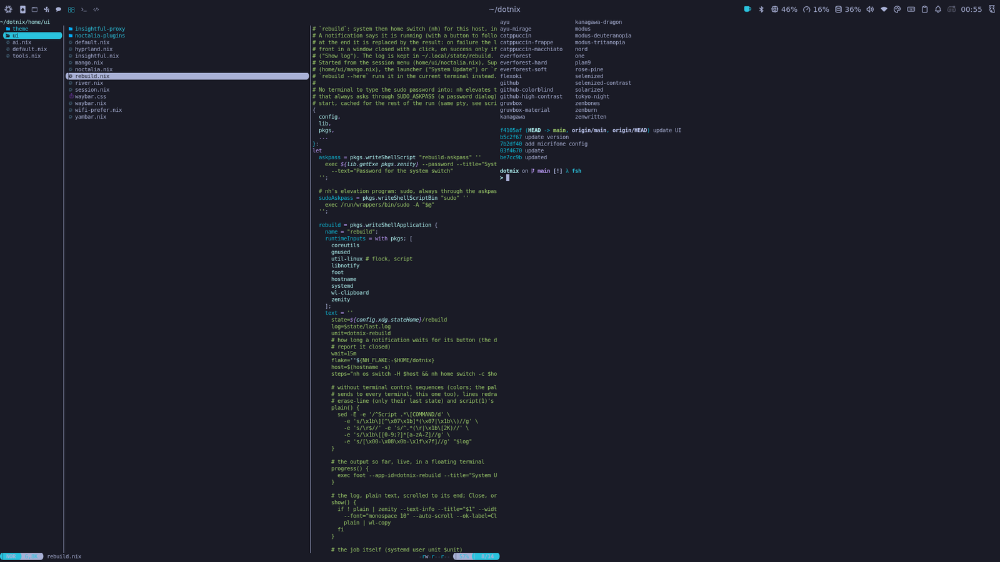
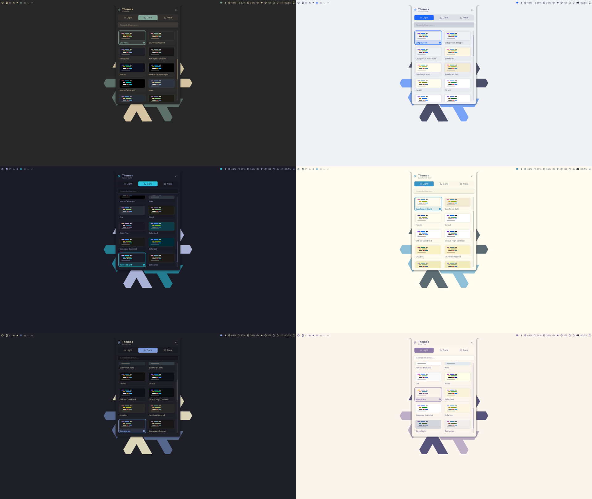
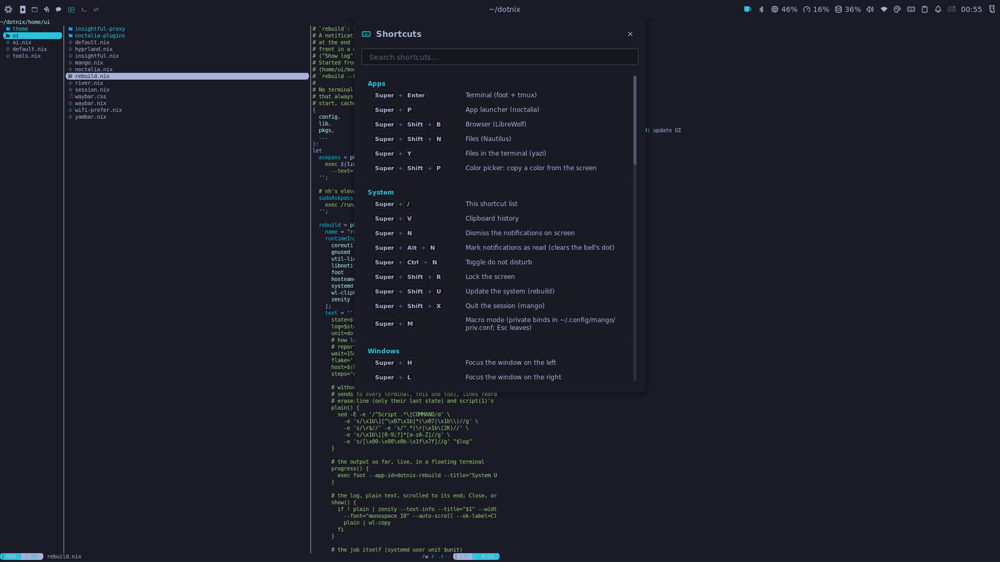

# Dotnix

My NixOS setup: system and home-manager in one flake, for my desktop (`bx`)
and laptop (`te`).

The disk is LUKS with btrfs on top. It unlocks from a key hidden in any USB
stick, and falls back to the password after 10 seconds.

The desktop is [mango](https://github.com/DreamMaoMao/mangowc) with
[noctalia](https://github.com/noctalia-dev/noctalia-shell) as the bar,
launcher, notifications and lock screen. Hyprland is still there as a
second session.



## Themes

There are 30 themes, each with a light and a dark variant (or `auto`, which
follows the sun). Everything is built ahead of time, so switching is instant:
the bar, terminals, GTK apps, Chromium/Brave, Emacs, the wallpaper and the
boot splash all change together. Pick one from the palette icon in the bar,
or from the terminal:

```sh
theme set gruvbox dark
theme toggle        # light <-> dark
theme list
```



## Fonts

Fonts switch live too: interface, serif, monospace, terminal and emoji each
pick from a catalog (`home/theme/fonts/catalog.nix`, all installed), with
their own sizes. GTK, Qt, the bar, Emacs, kitty/ghostty/alacritty, Discord
and Chromium/Brave pages change at once; foot and LibreWolf on their next
start. Right click the palette icon, or:

```sh
theme font                      # what is in use
theme font term "Iosevka"       # ROLE FAMILY: ui serif mono term emoji
theme font size +1              # every size; or: size term 9
theme font preset plex          # theme font presets
theme font list mono
```

`nix flake check` fails if a catalog family is missing from its package or
if any script, symbol or emoji would show as tofu.

## Shortcuts

`Super+/` opens a list of every key binding. The list is generated from the
same file that defines the binds (`home/ui/mango.nix`), so it never goes out
of date.



The ones I use most:

| Key | Does |
|---|---|
| `Super+Enter` | terminal |
| `Super+P` | launcher |
| `Super+1..0` | go to tag |
| `Super+Shift+1..0` | move window to tag |
| `Super+H/J/K/L` | move focus |
| `Super+Shift+Q` | close window |
| `Super+V` | clipboard history |
| `Super+Shift+U` | rebuild system and home |

## Install

`nix develop` has every tool used below (ISOs, sticks, the Go code).

Build an ISO and write it to a USB stick:

```sh
nix build .#iso-minimal   # or .#iso-full: this whole setup, live
dd if=result/iso/*.iso of=/dev/sdX bs=4M conv=fsync
```

Boot from it and run `dotnix-install`: it partitions and encrypts a disk,
adds `hosts/<host>` to the flake and installs it. `dotnix-mount` opens an
installed disk on `/mnt` for recovery.

Then `rebuild` (or `Super+Shift+U`) rebuilds system and home.

## Checks

```sh
nix flake check            # every host evaluates, Go tests, formatting
nix fmt                    # format
nix build .#usb-key-test   # boots VMs: unlock from a stick, PIN, password fallback
nix build .#usb-stick-test # boots a VM from a multiboot stick
```

## USB key

The key hides in the gap before the stick's first partition: the whole gap is
random bytes, the key somewhere in it, so the stick looks like any other and
keeps working as a normal drive. Next to the key goes a tag (HMAC-SHA512 made
with the key itself) naming the LUKS volume and key slot: at boot the initrd
reads the gap of every disk, recognizes the stick made for this disk in a few
milliseconds, and opens that one slot. Without the key the tag is just noise.

```sh
sudo dotnix-key create /dev/sdX        # a new key, in its own LUKS slot
sudo dotnix-key create -pin /dev/sdX   # the stick also needs a short PIN at boot
sudo dotnix-key adopt /dev/sdX         # a key written the old way (offset 2048)
sudo dotnix-key list                   # sticks found and what they open
```

Partitions and files are never touched, only the gap; a gap holding something
else (GRUB, Ventoy) is refused. Running `create` again replaces the stick's key
and revokes the old one. No stick, a stick for another machine or a wrong PIN
(three times): the password is asked.

Enable it on a host with `modules.usbKey.enable = true;`.

## Multiboot stick

One stick for everything: a FILES partition (FAT32, first, up to 4GiB), a GRUB
menu of Linux ISOs and the disk key. Without ISOs, `create` makes only FILES
(the whole stick) and the key; with them, FILES shrinks to fit a small stick.

```sh
nix run .#usb-stick -- create /dev/sdX .#iso-full .#iso-minimal ~/Downloads/zorin.iso
nix run .#usb-stick -- add /dev/sdX ~/Downloads/other.iso   # or replace one
nix run .#usb-stick -- remove /dev/sdX other.iso
nix run .#usb-stick -- list /dev/sdX
```

GRUB lists `isos/*.iso` of the ISOS partition at every boot, so copying or
deleting files there by hand works too; `add` also checks that the ISO boots
from a file and fits, and reads the copy back. Unsupported ISOs show up in the
menu as such. Booting from a file works for ISOs with `boot/grub/loopback.cfg`
(Ubuntu, Zorin, Mint, Debian live, Arch...) and for the NixOS ISOs of this
flake (`iso/findiso.nix`); upstream NixOS ISOs can't, their initrd reads no ext4.
